# IR & Code Generation - Architectural Design

## High-Level Module Overview

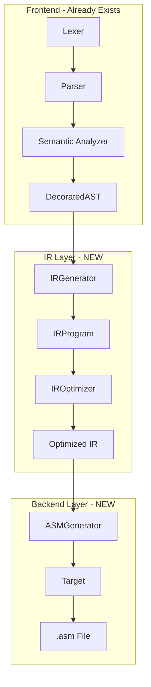

---

## Module 1: IR Module

### Purpose
Transform the DecoratedAST into a **platform-independent** intermediate representation that can be optimized and then lowered to any target architecture.

### Components

| Component | Responsibility |
|-----------|----------------|
| **IROpcode** | Enum defining all supported operations (ADD, SUB, JUMP, CALL, etc.) |
| **IROperand** | Represents an operand: temporary, variable, constant, or label |
| **IRInstruction** | Single three-address instruction (dest = src1 op src2) |
| **IRFunction** | Collection of instructions for one function + metadata |
| **IRProgram** | Collection of all functions + global data |
| **IRGenerator** | Walks AST and produces IR instructions |
| **IROptimizer** | Runs optimization passes on the IR |

### IR Instruction Format (Three-Address Code)

```
┌─────────────────────────────────────────────────────────┐
│                    IRInstruction                        │
├─────────────────────────────────────────────────────────┤
│  opcode: WHAT operation to perform                      │
│  dest:   WHERE to store the result                      │
│  src1:   FIRST input                                    │
│  src2:   SECOND input (optional)                        │
│  label:  For control flow (jumps, labels)               │
└─────────────────────────────────────────────────────────┘

Example: x = a + b
  → IRInstruction { opcode=ADD, dest=x, src1=a, src2=b }

Example: if (x == 0) goto L1
  → IRInstruction { opcode=JUMP_IF_ZERO, src1=x, label="L1" }
```

### IR Operand Types

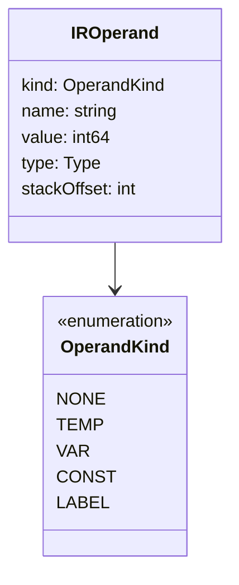

| Kind | Description | Example |
|------|-------------|---------|
| NONE | Unused operand | - |
| TEMP | Compiler-generated temporary | t0, t1, t2 |
| VAR | User-defined variable | x, counter |
| CONST | Immediate value | 42, 0, -1 |
| LABEL | Jump target | L1, if_end |

### IR Opcode Categories

```
┌─────────────────────────────────────────────────────────┐
│                    IR Operations                        │
├─────────────────────────────────────────────────────────┤
│ ARITHMETIC    │ ADD, SUB, MUL, DIV, MOD, NEG            │
├───────────────┼─────────────────────────────────────────┤
│ COMPARISON    │ CMP_EQ, CMP_NE, CMP_LT, CMP_GT,         │
│               │ CMP_LE, CMP_GE                          │
├───────────────┼─────────────────────────────────────────┤
│ LOGICAL       │ AND, OR, NOT                            │
├───────────────┼─────────────────────────────────────────┤
│ CONTROL FLOW  │ LABEL, JUMP, JUMP_IF_ZERO,              │
│               │ JUMP_IF_NOT_ZERO                        │
├───────────────┼─────────────────────────────────────────┤
│ MEMORY        │ LOAD, STORE, LOAD_CONST, COPY           │
├───────────────┼─────────────────────────────────────────┤
│ FUNCTION      │ FUNC_BEGIN, FUNC_END, PARAM, CALL,      │
│               │ RETURN                                  │
└───────────────┴─────────────────────────────────────────┘
```

### IRProgram Structure

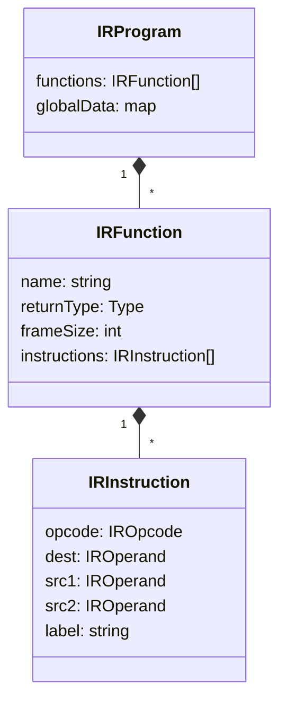

---

## Module 2: Target Abstraction

### Purpose
Abstract away platform-specific details (registers, calling conventions, instruction syntax) so the code generator works with **any** target.

### Target Composition

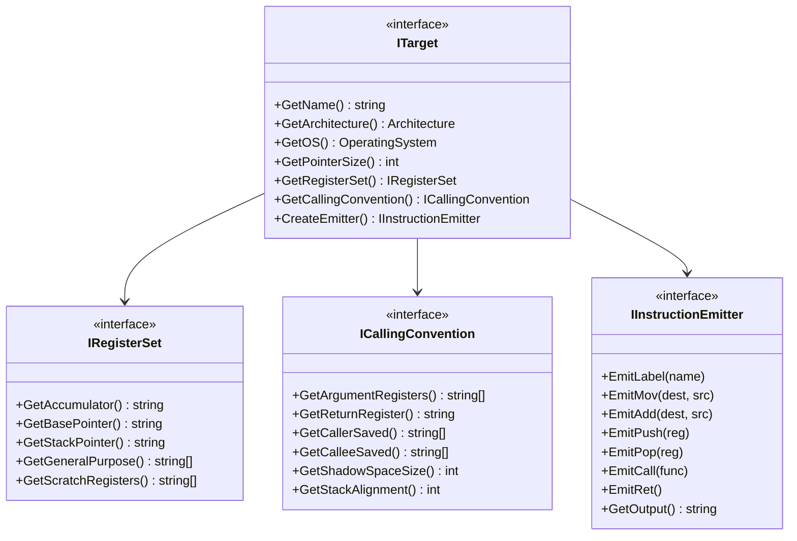

### Concrete Targets

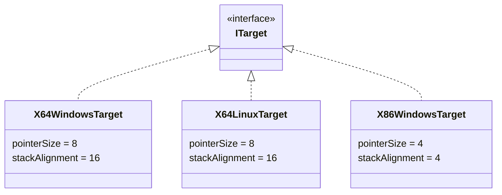

### Target Differences Summary

| Aspect | X64 Windows | X64 Linux | X86 Windows |
|--------|-------------|-----------|-------------|
| **Pointer Size** | 8 bytes | 8 bytes | 4 bytes |
| **Stack Alignment** | 16 bytes | 16 bytes | 4 bytes |
| **Arg Registers** | RCX, RDX, R8, R9 | RDI, RSI, RDX, RCX, R8, R9 | None (stack) |
| **Shadow Space** | 32 bytes | 0 bytes | 0 bytes |
| **Red Zone** | No | 128 bytes | No |
| **Return Reg** | RAX | RAX | EAX |

### Target Factory Pattern

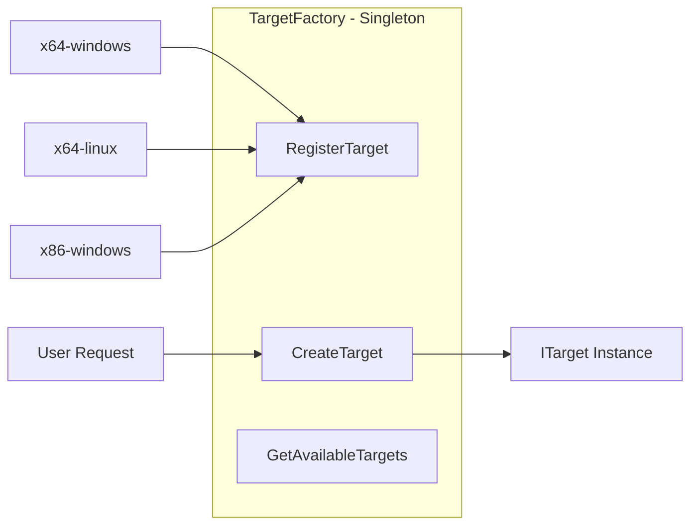

---

## Module 3: Code Generation

### Purpose
Convert IR instructions to target-specific assembly using the target abstraction.

### Code Generator Flow

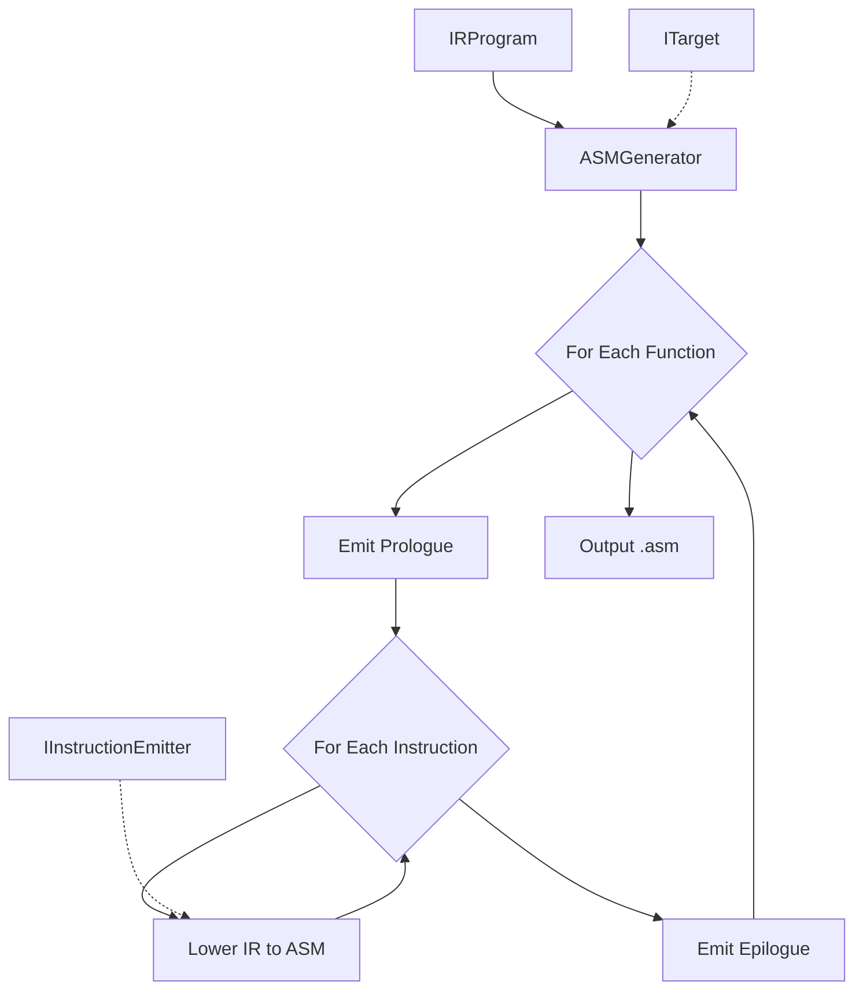

### Instruction Lowering Examples

| IR Instruction | x64 ASM (Windows) | x86 ASM |
|----------------|-------------------|---------|
| `t0 = ADD a, b` | `mov rax, [rbp-8]`<br>`add rax, [rbp-16]`<br>`mov [rbp-24], rax` | `mov eax, [ebp-4]`<br>`add eax, [ebp-8]`<br>`mov [ebp-12], eax` |
| `JUMP L1` | `jmp L1` | `jmp L1` |
| `JUMP_IF_ZERO t0, L1` | `cmp qword [rbp-24], 0`<br>`je L1` | `cmp dword [ebp-12], 0`<br>`je L1` |
| `CALL func` | `sub rsp, 32`<br>`call func`<br>`add rsp, 32` | `call func` |
| `RETURN t0` | `mov rax, [rbp-24]`<br>`leave`<br>`ret` | `mov eax, [ebp-12]`<br>`leave`<br>`ret` |

### Label Management

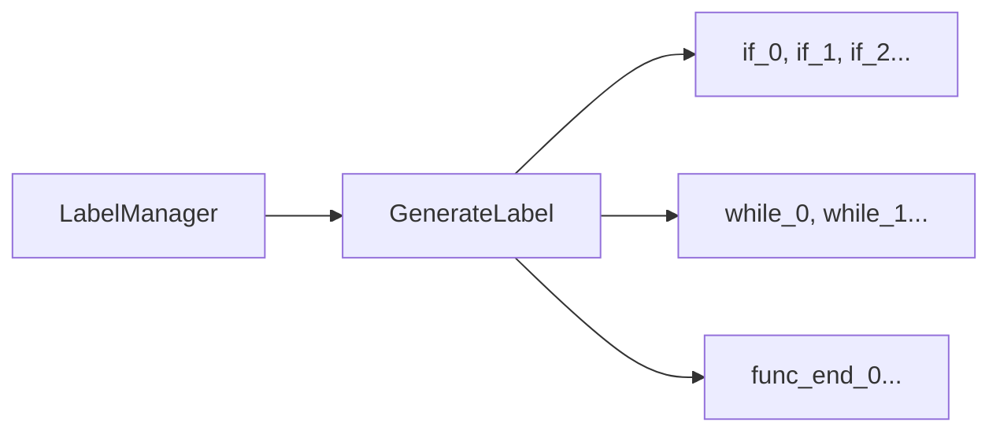

---

## Module Relationships

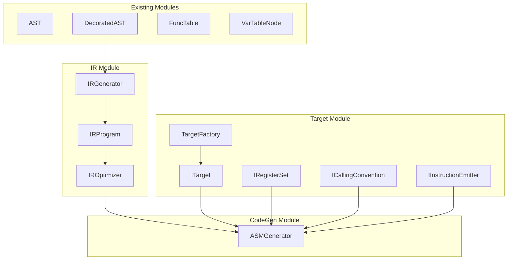

---

## Data Flow Example

For this source code:
```
func add(a: int, b: int) -> int {
    return a + b;
}
```

### Step 1: DecoratedAST (exists)
```
FuncDeclaration
├── name: "add"
├── params: [a: int, b: int]
├── returnType: int
└── body:
    └── Return
        └── Expression: a + b
```

### Step 2: IR Generation
```
FUNC_BEGIN "add", frameSize=16
  LOAD t0, a           ; t0 = a
  LOAD t1, b           ; t1 = b
  ADD t2, t0, t1       ; t2 = t0 + t1
  RETURN t2            ; return t2
FUNC_END
```

### Step 3: ASM Generation (x64 Windows)
```asm
add:
    push rbp
    mov rbp, rsp
    sub rsp, 16
    
    mov [rbp-8], rcx     ; save param a
    mov [rbp-16], rdx    ; save param b
    
    mov rax, [rbp-8]     ; load a
    add rax, [rbp-16]    ; add b
    
    leave
    ret
```

---

## File Organization

```
includes/
├── ir/
│   ├── ir_opcode.h           # Operation codes enum
│   ├── ir_operand.h          # Operand types
│   ├── ir_instruction.h      # Single instruction
│   ├── ir_function.h         # Function container
│   ├── ir_program.h          # Program container
│   ├── ir_generator.h        # AST → IR
│   └── ir_optimizer.h        # Optimization interface
│
├── target/
│   ├── architecture.h        # X86, X64, ARM64 enum
│   ├── operating_system.h    # Windows, Linux enum
│   ├── i_target.h            # Target interface
│   ├── i_register_set.h      # Register interface
│   ├── i_calling_convention.h# Calling convention interface
│   ├── i_instruction_emitter.h# ASM emitter interface
│   ├── target_factory.h      # Factory for creating targets
│   ├── x64/                  # x64 implementations
│   └── x86/                  # x86 implementations
│
└── codegen/
    ├── asm_generator.h       # IR → ASM
    └── label_manager.h       # Label generation
```

---

## Design Patterns Used

| Aspect | Pattern | Benefit |
|--------|---------|---------|
| Target Selection | **Strategy** | Swap backends at runtime |
| Target Creation | **Abstract Factory** | Consistent object families |
| AST Traversal | **Visitor** | Separate traversal from operations |
| Code Generation | **Template Method** | Shared algorithm, custom steps |
| Target Registration | **Factory + Singleton** | Centralized target management |

---

## Adding a New Target (Example: ARM64)

To add ARM64 support:

1. Create `includes/target/arm64/` folder
2. Implement `IRegisterSet` for ARM64 registers (x0-x30, sp, etc.)
3. Implement `ICallingConvention` for AAPCS64
4. Implement `IInstructionEmitter` for ARM64 instructions
5. Create `ARM64LinuxTarget` implementing `ITarget`
6. Register with `TargetFactory`

**No changes needed to IR or ASMGenerator!**

---

## Windows x64 Detailed Example

### Windows x64 Calling Convention (Microsoft x64 ABI)

```
┌─────────────────────────────────────────────────────────────────┐
│                 WINDOWS x64 CALLING CONVENTION                  │
├─────────────────────────────────────────────────────────────────┤
│ ARGUMENT PASSING:                                               │
│   Arg 1: RCX (or XMM0 for float)                                │
│   Arg 2: RDX (or XMM1 for float)                                │
│   Arg 3: R8  (or XMM2 for float)                                │
│   Arg 4: R9  (or XMM3 for float)                                │
│   Arg 5+: Stack (right to left)                                 │
├─────────────────────────────────────────────────────────────────┤
│ RETURN VALUE:                                                   │
│   Integer/Pointer: RAX                                          │
│   Float/Double: XMM0                                            │
├─────────────────────────────────────────────────────────────────┤
│ CALLER-SAVED (volatile - can be trashed by callee):             │
│   RAX, RCX, RDX, R8, R9, R10, R11, XMM0-XMM5                    │
├─────────────────────────────────────────────────────────────────┤
│ CALLEE-SAVED (non-volatile - must be preserved):                │
│   RBX, RBP, RDI, RSI, RSP, R12, R13, R14, R15, XMM6-XMM15       │
├─────────────────────────────────────────────────────────────────┤
│ SHADOW SPACE: 32 bytes (must be allocated by caller)            │
│ STACK ALIGNMENT: 16 bytes (RSP must be 16-byte aligned          │
│                  before CALL instruction)                       │
└─────────────────────────────────────────────────────────────────┘
```

### Windows x64 Stack Frame Layout

```
┌─────────────────────────────────────────────────────────────────┐
│                    STACK FRAME LAYOUT                           │
│                  (grows downward ↓)                             │
├─────────────────────────────────────────────────────────────────┤
│                                                                 │
│   Higher addresses                                              │
│   ┌─────────────────────────────┐                               │
│   │     Arg 6, 7, 8...          │  ← Passed by caller           │
│   │     (if more than 4 args)   │                               │
│   ├─────────────────────────────┤                               │
│   │     Shadow Space (32 bytes) │  ← Reserved by caller         │
│   │     [home for RCX,RDX,R8,R9]│     for callee to spill args  │
│   ├─────────────────────────────┤                               │
│   │     Return Address          │  ← Pushed by CALL             │
│   ├─────────────────────────────┤                               │
│   │     Saved RBP               │  ← push rbp                   │
│   ├─────────────────────────────┤  ← RBP points here            │
│   │     Local Variables         │                               │
│   │     Temporaries             │                               │
│   ├─────────────────────────────┤                               │
│   │     Saved Registers         │  ← Callee-saved regs          │
│   │     (RBX, R12-R15, etc.)    │                               │
│   ├─────────────────────────────┤                               │
│   │     Shadow Space for        │  ← If this function           │
│   │     outgoing calls (32 b)   │     calls others              │
│   └─────────────────────────────┘  ← RSP points here            │
│   Lower addresses                                               │
│                                                                 │
└─────────────────────────────────────────────────────────────────┘
```

### Complete Example: Function with If-Else and Function Call

**Source Code:**
```
func max(a: int, b: int) -> int {
    if (a > b) {
        return a;
    } else {
        return b;
    }
}

func calculate(x: int, y: int, z: int) -> int {
    var result: int = 0;
    result = max(x, y);
    result = result + z;
    return result;
}
```

---

### Step 1: IR Generation for `max` function

```
FUNC_BEGIN "max", frameSize=32
    ; Parameters: a at [rbp-8], b at [rbp-16]
    ; Temps start at [rbp-24]
    
    LOAD t0, a                    ; t0 = a
    LOAD t1, b                    ; t1 = b
    CMP_GT t2, t0, t1             ; t2 = (a > b)
    JUMP_IF_ZERO t2, "else_0"     ; if not (a > b), goto else
    
    ; if-branch
    LOAD t3, a                    ; t3 = a
    RETURN t3                     ; return a
    JUMP "if_end_0"
    
    LABEL "else_0"
    ; else-branch
    LOAD t4, b                    ; t4 = b
    RETURN t4                     ; return b
    
    LABEL "if_end_0"
FUNC_END
```

### Step 2: x64 Windows ASM for `max`

```asm
; ============================================
; Function: max(a: int, b: int) -> int
; Parameters: a in RCX, b in RDX
; Return: RAX
; ============================================

section .text
global max

max:
    ; === PROLOGUE ===
    push    rbp                     ; Save old base pointer
    mov     rbp, rsp                ; Set new base pointer
    sub     rsp, 32                 ; Allocate stack (32 bytes for locals + alignment)
    
    ; === SAVE PARAMETERS TO SHADOW/LOCAL SPACE ===
    mov     [rbp-8], rcx            ; Save param 'a' to local
    mov     [rbp-16], rdx           ; Save param 'b' to local
    
    ; === COMPARISON: if (a > b) ===
    mov     rax, [rbp-8]            ; Load a into RAX
    cmp     rax, [rbp-16]           ; Compare a with b
    jle     .else_0                 ; If a <= b, jump to else
    
    ; === IF BRANCH: return a ===
    mov     rax, [rbp-8]            ; Return value = a
    jmp     .epilogue               ; Jump to epilogue
    
.else_0:
    ; === ELSE BRANCH: return b ===
    mov     rax, [rbp-16]           ; Return value = b
    
.epilogue:
    ; === EPILOGUE ===
    leave                           ; Restore RSP and RBP (mov rsp, rbp; pop rbp)
    ret                             ; Return to caller
```

---

### Step 1: IR Generation for `calculate` function

```
FUNC_BEGIN "calculate", frameSize=64
    ; Parameters: x at [rbp-8], y at [rbp-16], z at [rbp-24]
    ; Local 'result' at [rbp-32]
    ; Temps start at [rbp-40]
    
    ; var result: int = 0
    LOAD_CONST t0, 0              ; t0 = 0
    STORE result, t0              ; result = 0
    
    ; result = max(x, y)
    LOAD t1, x                    ; t1 = x (first arg)
    PARAM t1                      ; push param 1
    LOAD t2, y                    ; t2 = y (second arg)
    PARAM t2                      ; push param 2
    CALL t3, "max", 2             ; t3 = max(x, y)
    STORE result, t3              ; result = t3
    
    ; result = result + z
    LOAD t4, result               ; t4 = result
    LOAD t5, z                    ; t5 = z
    ADD t6, t4, t5                ; t6 = result + z
    STORE result, t6              ; result = t6
    
    ; return result
    LOAD t7, result               ; t7 = result
    RETURN t7                     ; return result
FUNC_END
```

### Step 2: x64 Windows ASM for `calculate`

```asm
; ============================================
; Function: calculate(x: int, y: int, z: int) -> int
; Parameters: x in RCX, y in RDX, z in R8
; Return: RAX
; ============================================

section .text
global calculate
extern max

calculate:
    ; === PROLOGUE ===
    push    rbp                     ; Save old base pointer
    mov     rbp, rsp                ; Set new base pointer
    sub     rsp, 64                 ; Stack: 24 (params) + 8 (result) + 32 (shadow for calls)
    
    ; === SAVE PARAMETERS ===
    mov     [rbp-8], rcx            ; Save x
    mov     [rbp-16], rdx           ; Save y
    mov     [rbp-24], r8            ; Save z
    
    ; === var result: int = 0 ===
    mov     qword [rbp-32], 0       ; result = 0
    
    ; === result = max(x, y) ===
    ; Prepare arguments for max()
    mov     rcx, [rbp-8]            ; Arg 1: x -> RCX
    mov     rdx, [rbp-16]           ; Arg 2: y -> RDX
    ; Shadow space already allocated in our frame
    call    max                     ; Call max(x, y)
    mov     [rbp-32], rax           ; result = return value
    
    ; === result = result + z ===
    mov     rax, [rbp-32]           ; Load result
    add     rax, [rbp-24]           ; Add z
    mov     [rbp-32], rax           ; Store back to result
    
    ; === return result ===
    mov     rax, [rbp-32]           ; Return value = result
    
    ; === EPILOGUE ===
    leave                           ; Restore stack frame
    ret                             ; Return
```

---

### Example: While Loop

**Source Code:**
```
func sum_to_n(n: int) -> int {
    var sum: int = 0;
    var i: int = 1;
    while (i <= n) {
        sum = sum + i;
        i = i + 1;
    }
    return sum;
}
```

### IR Generation

```
FUNC_BEGIN "sum_to_n", frameSize=48
    ; Parameter: n at [rbp-8]
    ; Local 'sum' at [rbp-16]
    ; Local 'i' at [rbp-24]
    
    ; var sum: int = 0
    LOAD_CONST t0, 0
    STORE sum, t0
    
    ; var i: int = 1
    LOAD_CONST t1, 1
    STORE i, t1
    
    LABEL "while_cond_0"
    ; while (i <= n)
    LOAD t2, i
    LOAD t3, n
    CMP_LE t4, t2, t3             ; t4 = (i <= n)
    JUMP_IF_ZERO t4, "while_end_0"
    
    ; sum = sum + i
    LOAD t5, sum
    LOAD t6, i
    ADD t7, t5, t6
    STORE sum, t7
    
    ; i = i + 1
    LOAD t8, i
    LOAD_CONST t9, 1
    ADD t10, t8, t9
    STORE i, t10
    
    JUMP "while_cond_0"
    
    LABEL "while_end_0"
    ; return sum
    LOAD t11, sum
    RETURN t11
FUNC_END
```

### x64 Windows ASM

```asm
; ============================================
; Function: sum_to_n(n: int) -> int
; Parameter: n in RCX
; Return: RAX
; ============================================

section .text
global sum_to_n

sum_to_n:
    ; === PROLOGUE ===
    push    rbp
    mov     rbp, rsp
    sub     rsp, 48                 ; Space for n, sum, i + alignment
    
    ; === SAVE PARAMETER ===
    mov     [rbp-8], rcx            ; Save n
    
    ; === var sum: int = 0 ===
    mov     qword [rbp-16], 0       ; sum = 0
    
    ; === var i: int = 1 ===
    mov     qword [rbp-24], 1       ; i = 1
    
.while_cond_0:
    ; === CONDITION: while (i <= n) ===
    mov     rax, [rbp-24]           ; Load i
    cmp     rax, [rbp-8]            ; Compare i with n
    jg      .while_end_0            ; If i > n, exit loop
    
    ; === BODY: sum = sum + i ===
    mov     rax, [rbp-16]           ; Load sum
    add     rax, [rbp-24]           ; Add i
    mov     [rbp-16], rax           ; Store sum
    
    ; === BODY: i = i + 1 ===
    mov     rax, [rbp-24]           ; Load i
    inc     rax                     ; i + 1
    mov     [rbp-24], rax           ; Store i
    
    jmp     .while_cond_0           ; Loop back
    
.while_end_0:
    ; === return sum ===
    mov     rax, [rbp-16]           ; Return value = sum
    
    ; === EPILOGUE ===
    leave
    ret
```

---

### Stack Frame Calculation for Windows x64

```
┌─────────────────────────────────────────────────────────────────┐
│              STACK FRAME SIZE CALCULATION                       │
├─────────────────────────────────────────────────────────────────┤
│                                                                 │
│  Frame Size = Parameters + Locals + Temps + Shadow + Alignment  │
│                                                                 │
│  Rules:                                                         │
│  1. Each local variable: 8 bytes (for 64-bit integers)          │
│  2. Shadow space: 32 bytes (if function calls others)           │
│  3. Total must be 16-byte aligned (after CALL pushes return)    │
│                                                                 │
│  Example for calculate():                                       │
│    - Parameters saved: 3 × 8 = 24 bytes                         │
│    - Local 'result': 8 bytes                                    │
│    - Shadow space: 32 bytes (calls max())                       │
│    - Total: 64 bytes (already 16-aligned)                       │
│                                                                 │
└─────────────────────────────────────────────────────────────────┘
```

---

## CodeGenFacade - Main Orchestrator

### Purpose
Single entry point that orchestrates the entire backend pipeline: **DecoratedAST → IR → Optimized IR → ASM → File**

### Component Diagram

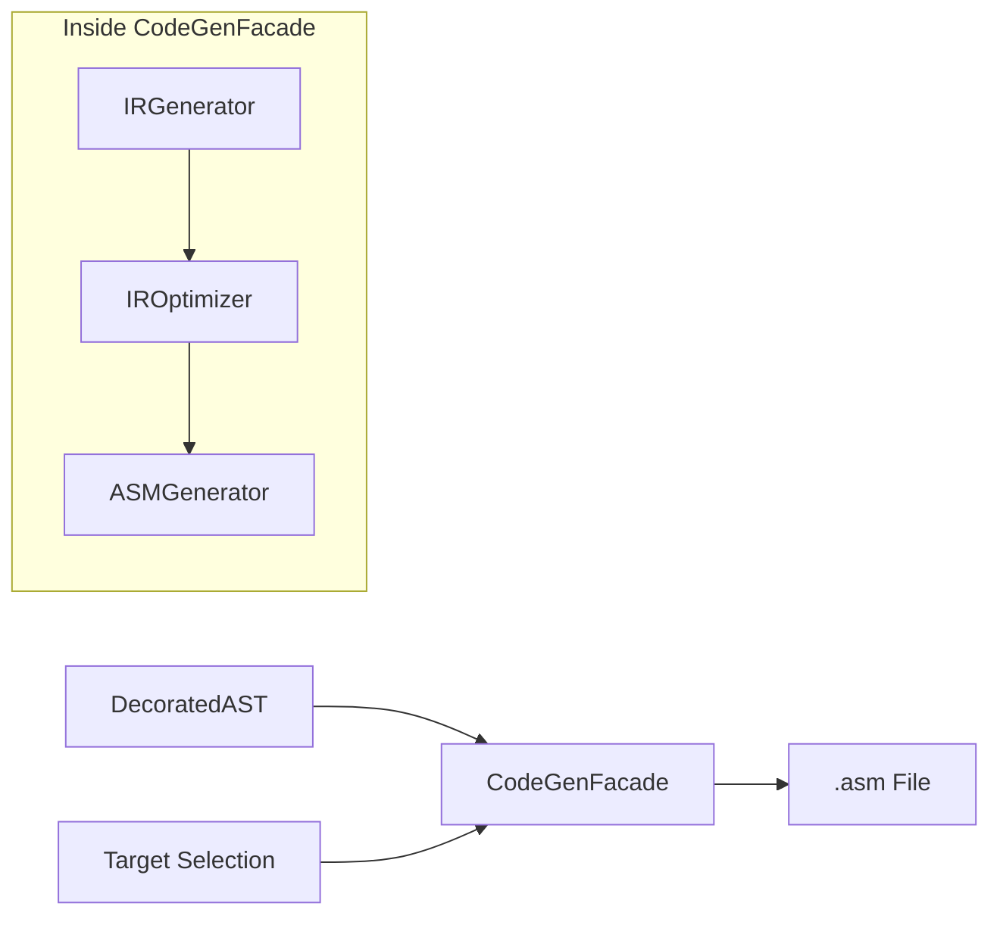

### Responsibilities

| Step | Action | Uses |
|------|--------|------|
| 1 | Accept DecoratedAST and target name | Input |
| 2 | Create target from TargetFactory | `TargetFactory` |
| 3 | Generate IR from AST | `IRGenerator` |
| 4 | Optimize IR (optional) | `IROptimizer` |
| 5 | Generate ASM from IR | `ASMGenerator` |
| 6 | Write output to .asm file | File I/O |

### Class Diagram

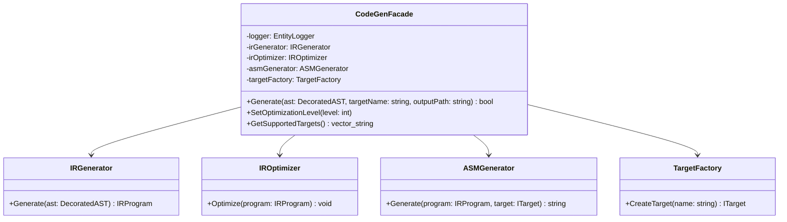

### Flow Diagram

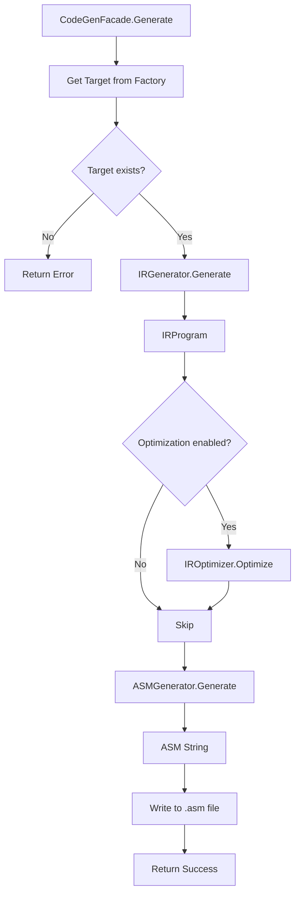

---

## Pipeline Abstraction

### The Pattern

Each stage transforms from one representation to another:
```
Source → IR → ASM → Binary
```

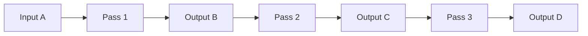

### ICompilationPass Interface

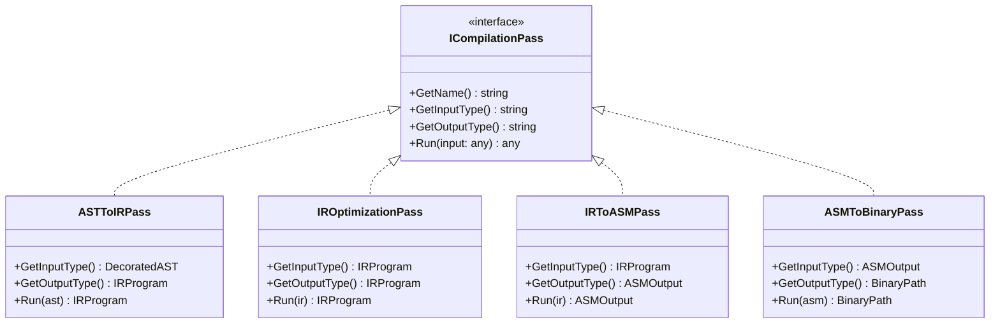

### CompilationPipeline Orchestrator

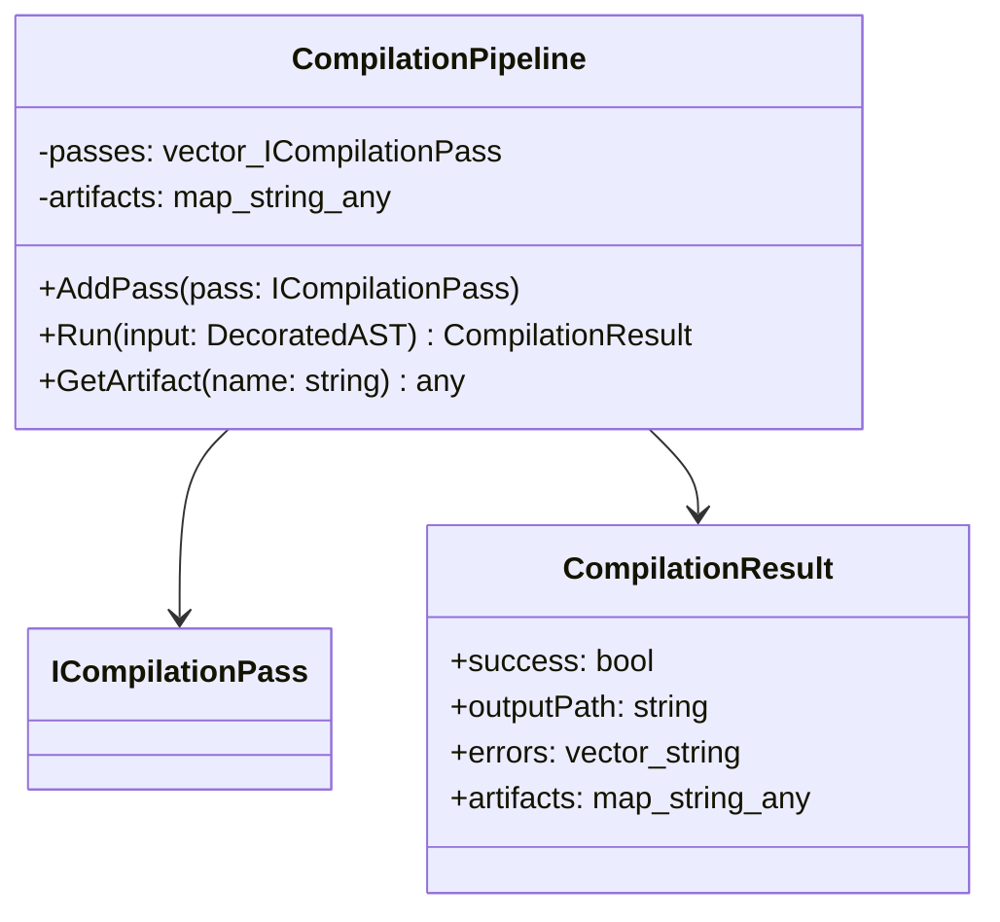

### Pipeline Flow

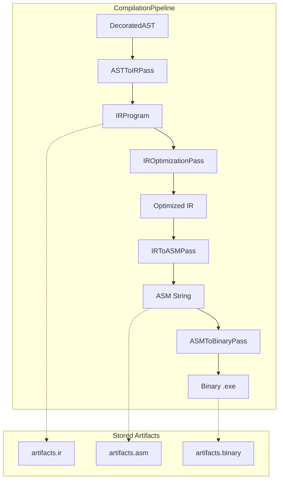

### Pass Descriptions

```
┌─────────────────────────────────────────────────────────────┐
│                      ASTToIRPass                            │
├─────────────────────────────────────────────────────────────┤
│ Input:  DecoratedAST                                        │
│ Output: IRProgram                                           │
│ Uses:   IRGenerator                                         │
└─────────────────────────────────────────────────────────────┘

┌─────────────────────────────────────────────────────────────┐
│                   IROptimizationPass                        │
├─────────────────────────────────────────────────────────────┤
│ Input:  IRProgram                                           │
│ Output: IRProgram (optimized)                               │
│ Uses:   IROptimizer                                         │
│ Config: optimization_level (0, 1, 2, 3)                     │
└─────────────────────────────────────────────────────────────┘

┌─────────────────────────────────────────────────────────────┐
│                      IRToASMPass                            │
├─────────────────────────────────────────────────────────────┤
│ Input:  IRProgram                                           │
│ Output: ASMOutput (string + metadata)                       │
│ Uses:   ASMGenerator, ITarget                               │
│ Config: target_name (x64-windows, x64-linux, etc.)          │
└─────────────────────────────────────────────────────────────┘

┌─────────────────────────────────────────────────────────────┐
│                     ASMToBinaryPass                         │
├─────────────────────────────────────────────────────────────┤
│ Input:  ASMOutput                                           │
│ Output: BinaryPath (path to .exe/.out)                      │
│ Uses:   External assembler (NASM, MASM, GAS)                │
│         External linker (link.exe, ld)                      │
│ Config: assembler_path, linker_path, output_format          │
└─────────────────────────────────────────────────────────────┘
```

### Benefits of Pipeline Abstraction

| Benefit | Description |
|---------|-------------|
| **Extensibility** | Add new passes without changing existing code |
| **Swappable** | Use NASM on one machine, MASM on another |
| **Testable** | Test each pass in isolation |
| **Configurable** | Enable/disable passes via config |
| **Debuggable** | Inspect artifacts at each stage |
| **Cacheable** | Skip unchanged passes (future) |

---

## Design Patterns - Complete Reference

### 1. Pipeline Pattern (Pipes and Filters)

**Where:** Overall compilation flow

**Purpose:** Chain transformations where output of one stage feeds into the next


| Component | Role |
|-----------|------|
| `ICompilationPass` | Filter interface |
| `CompilationPipeline` | Pipe coordinator |
| Each Pass | Individual filter |

---

### 2. Strategy Pattern

**Where:** Target selection, Assembler selection

**Purpose:** Swap algorithms/implementations at runtime without changing client code

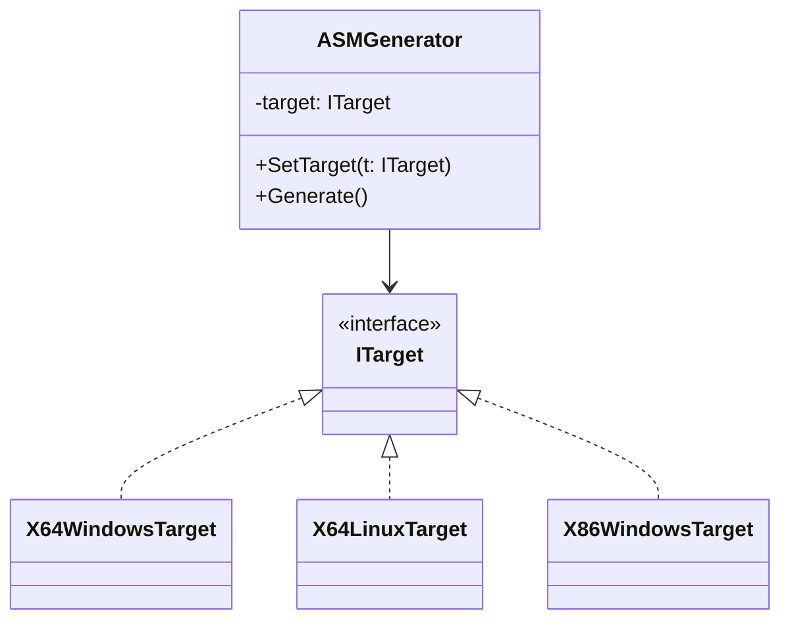

| Interface | Strategies |
|-----------|------------|
| `ITarget` | X64WindowsTarget, X64LinuxTarget, X86WindowsTarget |
| `ICallingConvention` | WindowsX64Convention, SystemVConvention, CdeclConvention |
| `IAssemblerPass` | NASMAssemblerPass, MASMAssemblerPass, GASAssemblerPass |

---

### 3. Abstract Factory Pattern

**Where:** Target creation

**Purpose:** Create families of related objects (registers, conventions, emitters) together

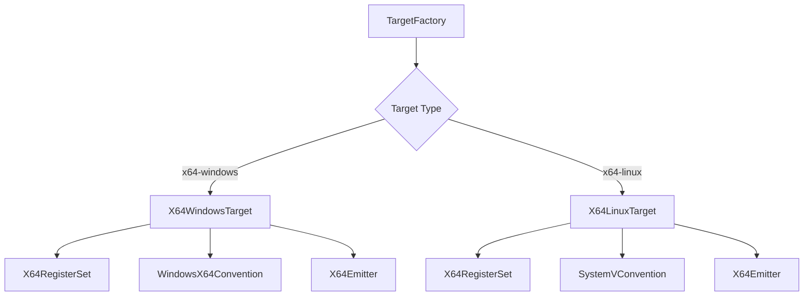

---

### 4. Factory Method Pattern

**Where:** TargetFactory, LabelManager

**Purpose:** Centralized object creation with registration

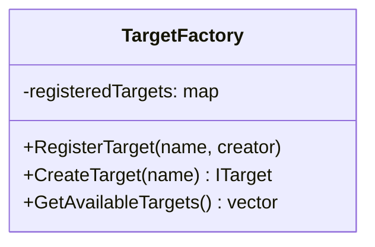

---

### 5. Visitor Pattern

**Where:** IR Generation (AST traversal)

**Purpose:** Separate algorithm (IR generation) from data structure (AST)

```mermaid
classDiagram
    class ASTNode {
        +Accept(visitor)
    }
    
    class IASTVisitor {
        <<interface>>
        +VisitVarDeclaration()
        +VisitAssignment()
        +VisitIfStatement()
        +VisitWhileLoop()
        +VisitFuncDeclaration()
        +VisitFuncCall()
        +VisitReturn()
    }
    
    class IRGenerator {
        +VisitVarDeclaration()
        +VisitIfStatement()
    }
    
    IASTVisitor <|.. IRGenerator
    ASTNode --> IASTVisitor
```

---

### 6. Template Method Pattern

**Where:** Code generation base class

**Purpose:** Define algorithm skeleton, let subclasses override specific steps

```mermaid
classDiagram
    class CodeGeneratorBase {
        <<abstract>>
        +Generate(ir: IRProgram)
        #EmitPrologue()*
        #EmitInstruction(instr)*
        #EmitEpilogue()*
    }
    
    class X64CodeGenerator {
        #EmitPrologue()
        #EmitInstruction(instr)
        #EmitEpilogue()
    }
    
    class X86CodeGenerator {
        #EmitPrologue()
        #EmitInstruction(instr)
        #EmitEpilogue()
    }
    
    CodeGeneratorBase <|-- X64CodeGenerator
    CodeGeneratorBase <|-- X86CodeGenerator
```

**Algorithm Skeleton:**
```
Generate(ir):
    for each function:
        EmitPrologue()      ← override
        for each instruction:
            EmitInstruction()  ← override
        EmitEpilogue()      ← override
```

---

### 7. Singleton Pattern

**Where:** TargetFactory (optional)

**Purpose:** Single global access point to target registry

```mermaid
classDiagram
    class TargetFactory {
        -instance: TargetFactory
        -TargetFactory()
        +GetInstance() TargetFactory
        +CreateTarget(name) ITarget
    }
```

---

### 8. Facade Pattern

**Where:** CodeGenFacade / CompilationPipeline

**Purpose:** Provide simple interface to complex subsystem

```mermaid
flowchart TD
    A[Client Code] --> B[CodeGenFacade]
    
    subgraph Hidden_Complexity [Hidden Complexity]
        B --> C[IRGenerator]
        B --> D[IROptimizer]
        B --> E[ASMGenerator]
        B --> F[TargetFactory]
        B --> G[File IO]
    end
```

---

### 9. Builder Pattern

**Where:** Pipeline configuration

**Purpose:** Construct complex pipeline step by step

```mermaid
classDiagram
    class PipelineBuilder {
        +WithTarget(name) PipelineBuilder
        +WithOptimization(level) PipelineBuilder
        +WithAssembler(name) PipelineBuilder
        +WithOutput(path) PipelineBuilder
        +Build() CompilationPipeline
    }
```

---

### Pattern Summary Table

| Pattern | Where Applied | Benefit |
|---------|---------------|---------|
| **Pipeline** | Overall flow | Clear transformation stages |
| **Strategy** | Targets, Assemblers | Swap implementations at runtime |
| **Abstract Factory** | Target creation | Consistent related objects |
| **Factory Method** | TargetFactory | Centralized creation |
| **Visitor** | AST traversal | Separate traversal from operations |
| **Template Method** | Code generation | Reuse algorithm, customize steps |
| **Singleton** | TargetFactory | Global access point |
| **Facade** | CodeGenFacade | Simple API to complex system |
| **Builder** | Pipeline config | Fluent configuration |

---

### Patterns in Architecture - Visual Overview

```mermaid
flowchart TD
    subgraph Facade [Facade Pattern]
        A[CodeGenFacade / CompilationPipeline]
    end
    
    subgraph Pipeline [Pipeline Pattern]
        B[Pass 1: AST to IR] --> C[Pass 2: IR to IR] --> D[Pass 3: IR to ASM] --> E[Pass 4: ASM to Binary]
    end
    
    subgraph Visitor [Visitor Pattern]
        B --> F[IRGenerator visits AST nodes]
    end
    
    subgraph Strategy [Strategy Pattern]
        D --> G[ITarget]
        G --> H[X64Windows]
        G --> I[X64Linux]
    end
    
    subgraph AbstractFactory [Abstract Factory]
        H --> J[RegisterSet + Convention + Emitter]
    end
    
    subgraph Factory [Factory Method]
        K[TargetFactory] --> G
    end
    
    subgraph TemplateMethod [Template Method]
        D --> L[CodeGeneratorBase.Generate]
        L --> M[EmitPrologue]
        L --> N[EmitInstruction]
        L --> O[EmitEpilogue]
    end
    
    A --> B
```

---

## Updated File Structure

```
includes/
├── ir/
│   ├── ir_opcode.h              # Operation codes enum
│   ├── ir_operand.h             # Operand types
│   ├── ir_instruction.h         # Single instruction
│   ├── ir_function.h            # Function container
│   ├── ir_program.h             # Program container
│   ├── ir_generator.h           # AST → IR
│   └── ir_optimizer.h           # Optimization interface
│
├── target/
│   ├── architecture.h           # X86, X64, ARM64 enum
│   ├── operating_system.h       # Windows, Linux enum
│   ├── i_target.h               # Target interface
│   ├── i_register_set.h         # Register interface
│   ├── i_calling_convention.h   # Calling convention interface
│   ├── i_instruction_emitter.h  # ASM emitter interface
│   ├── target_factory.h         # Factory for creating targets
│   ├── x64/                     # x64 implementations
│   └── x86/                     # x86 implementations
│
├── codegen/
│   ├── codegen_facade.h         # Main orchestrator (Facade)
│   ├── asm_generator.h          # IR → ASM
│   └── label_manager.h          # Label generation
│
└── pipeline/
    ├── i_compilation_pass.h     # Base pass interface
    ├── compilation_pipeline.h   # Pipeline orchestrator
    ├── compilation_result.h     # Result/artifacts container
    ├── ast_to_ir_pass.h         # Pass: AST → IR
    ├── ir_optimization_pass.h   # Pass: IR → IR
    ├── ir_to_asm_pass.h         # Pass: IR → ASM
    └── asm_to_binary_pass.h     # Pass: ASM → Binary
```

---

## Implementation Priority

1. **Phase 1**: IR Module (platform-agnostic foundation)
2. **Phase 2**: Target interfaces (abstractions)
3. **Phase 3**: X64 Windows target (first concrete implementation)
4. **Phase 4**: X64 Linux target (second implementation)
5. **Phase 5**: ASM Generator (uses targets)
6. **Phase 6**: CodeGenFacade / Pipeline integration
7. **Phase 7**: Integration with compiler_orchestrator
8. **Future**: X86 targets, optimizations, ARM64, ASM to Binary pass

